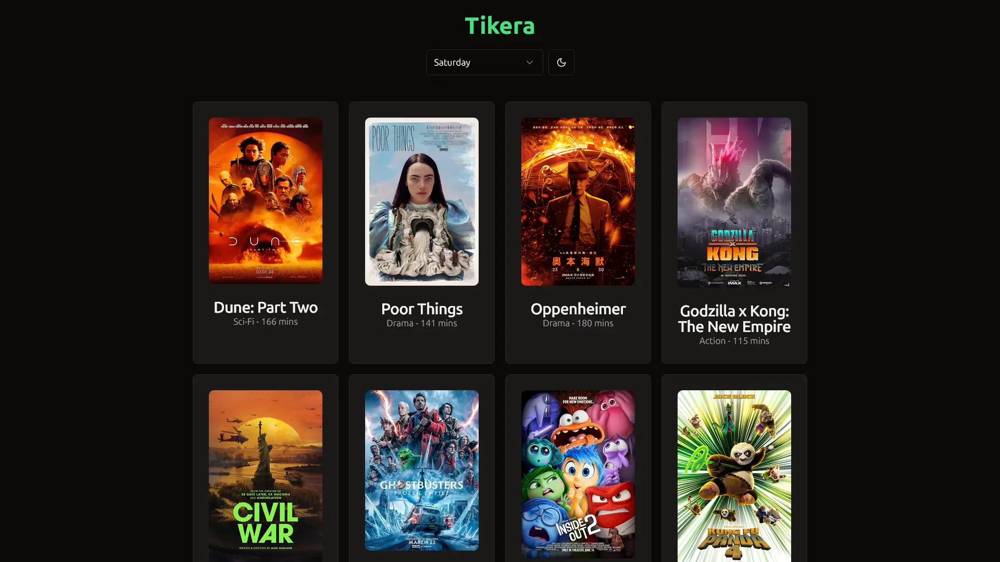
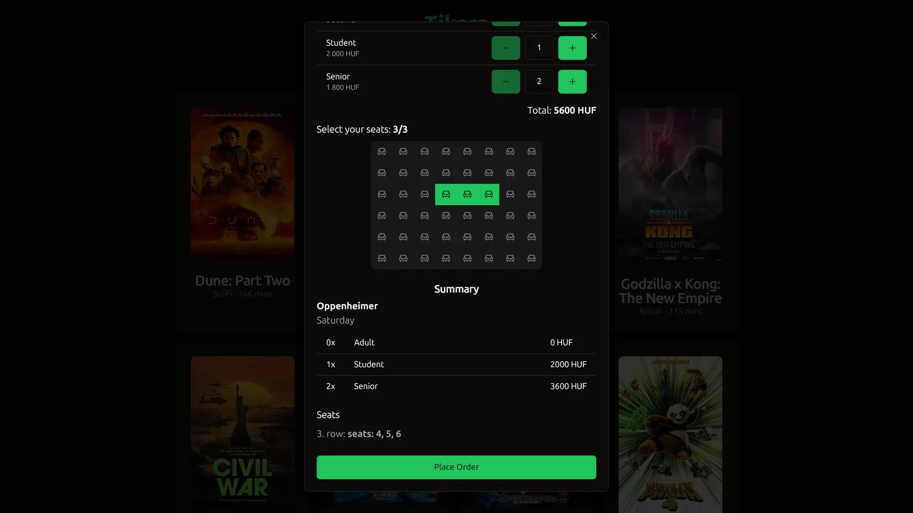

# Tikera

During my client-side web development course at Eötvös Loránd University, one of the assignments was to create a movie ticket booking frontend with React. Following modern web development practices, we had to create components, manage state, and handle routing.

I decided to use TypeScript and UnoCSS with the shadcn UI library, while keeping everything responsive across different screen sizes. The site implements a full booking flow, complete with time selection, ticket types, seat selection and price calculation.

I made sure to follow best practices and to write clean and potentially maintainable code. As a result, I received maximum points for the assignment, and I am proud of the final result.

